# 页间 · Page Between

一个面向 macOS 的个人阅读应用：原生 EPUB、保留版面的 PDF、可分页的文字书，以及随窗口大小调整字号的掌上阅读窗口。

A local-first reading prototype with native EPUB navigation, enhanced PDF selection, paginated text, and a compact macOS reading window.

当前已有可独立安装的 macOS App，功能与代码继续用于**产品交互与代码评审**。主体是 HTML / CSS / JavaScript、Python 本地服务，以及原生主窗口、OCR、掌上窗口和钥匙串组件。完整功能与安装交付的验收清单见 [App 改造与交付](docs/APP_READINESS.md)。


> 仓库中的书目、封面、插图、正文和截图全部使用自编的虚构演示资料。真实书籍、个人阅读记录、OCR 缓存、凭据与旧截图不在版本控制中。

## macOS App 构建（0.5.7 / 前端 2.28）

已有原生主窗口、菜单、文件面板、同进程掌上窗口与受管理的本机阅读服务。安装版的数据位于用户的 Application Support / Caches，运行时使用随包组件；下面的开发工具只在构建机器上需要。

```sh
python -m pip install -r requirements-build.txt
python scripts/build_app.py
# 匿名演示：python scripts/build_app.py --demo
python scripts/verify_app.py "$HOME/Library/Caches/Page Between/build/页间.app"
# 发布前另下载官方 EPUBCheck，并验证实际安装包的各条导出路径：
python scripts/verify_app.py "$HOME/Library/Caches/Page Between/build/页间.app" --epubcheck /path/to/epubcheck.jar
```

构建结果默认位于用户的 `Library/Caches/Page Between/build/`。当前在 Apple Silicon、macOS 27.0.1 验证，签名为本机构建的 ad-hoc 签名；其他系统版本和正式分发尚待验收。旧书库可使用 `python scripts/migrate_library.py data` 复制到安装版，已有目标不会覆盖，原目录保留。

当前 App 仍在持续开发，完整交互与安装验收见 [完整验收清单](docs/APP_READINESS.md)。以下是从源码运行原型的方式。

2.28 修复 MinerU 上传后重启时可能重复创建云任务的问题。上传完成状态随进度保存，云端暂未确认文件时继续查询原任务；若上传中断，先等待确认，再提示使用「重新提交解析」，不会自动另建任务。Token 和签名上传地址不写入任务记录。

2.23 调整全局快捷键的系统事件接收入口，并保护后台翻页尚未保存的位置，避免被其他窗口的同步覆盖。窗口内用 ← / →，后台用 ⌃⌥⌘← / ⌃⌥⌘→；实际后台组合键是否送达仍需桌面验证。诊断会分别保存登记状态、收到的快捷键次数及 WebKit 执行错误，保存在本机数据目录。

桌面版阅读设置中可选后台翻页按键：方向键、P / N（上一页 / 下一页），或关闭后台翻页；组合键均为 Control + Option + Command。设置会保存，并同步到已经打开的小窗。仅在小窗正文就绪后登记按键，关闭小窗会释放；关闭后台按键仍可在窗口内用普通方向键翻页。网页版会说明桌面窗口提供的能力。

2.25 修复多个目录章节共用一个 EPUB 正文文件时，始终高亮最后一章的问题。目录、位置说明和新书签标题跟随正文锚点；支持跳转、返回、重开与掌上重排。正常阅读及无关的书架更新保留目录节点与键盘焦点；PDF 滚动和跳页也只更新当前位置。

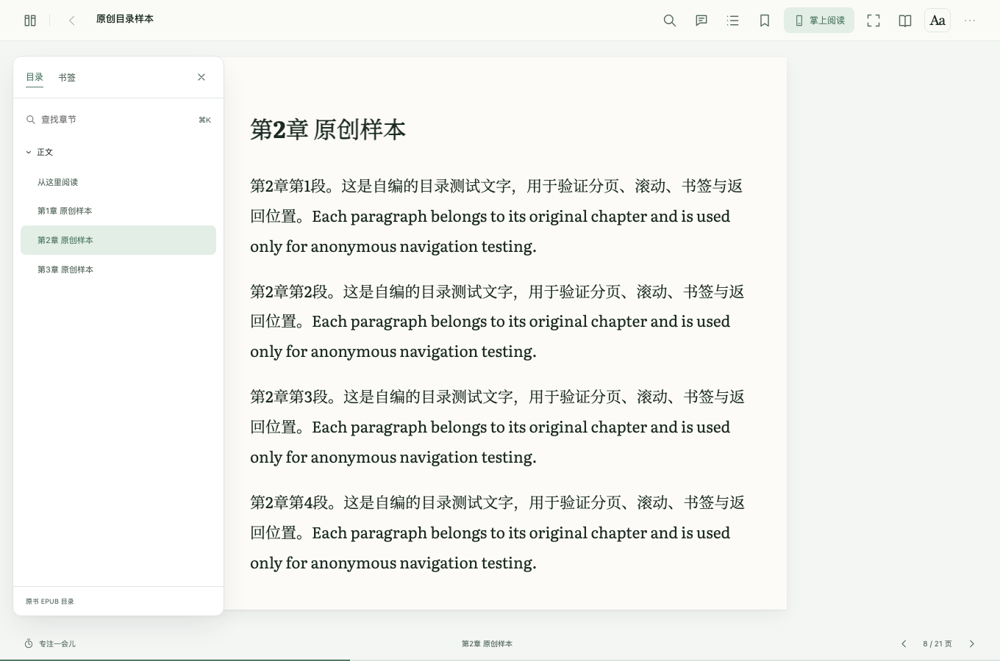

2.26 将章节定位用于答疑出处：同一页有多章时，选段引用按实际段落归属；书内检索也保存目录章节锚点，新对话使用对应章节名称。附加注释单独标为原书附加内容。索引更新会自动重建缓存，历史对话保留原有来源快照。

2.27 修复 HTML / Markdown 内嵌图片的转换和导出，并补齐无标题文档的 EPUB 信息及 ODT 目录锚点。导入采用单文件：图片应已内嵌或包含在 DOCX、ODT、FB2 等文件包中；引用未提供的外部图片会给出具体错误。旧转换结果中的图片链接可直接阅读，重新导出时从原始文件生成标准副本。

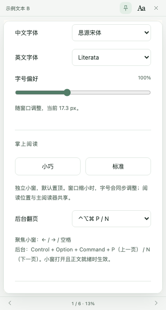

2.22 修复 WebKit 中点击 EPUB 正文后的翻页与划词，并处理跨章动画中断后的翻页状态；原书代码仍经过清理并由独立 CSP 禁止执行。取消选区或按 Esc 会收起复制 / 提问菜单；答疑面板可拖动标题移动，聚焦标题后也可用方向键微调。掌上窗口使用系统标题栏移动，并恢复上次窗口位置。

扫描 PDF 的本机 OCR 改为字符坐标：中文使用 Vision 字符框，英文使用 Tesseract hOCR 字符框，避免整词拉伸后选区边界偏移。公式、表格与插图仍完整取用；模糊扫描、识别漏字和不可靠的结构对齐仍可能影响结果。

## 快速开始

已验证环境：Python 3.12、Node.js 22，以及 macOS 上的 Swift 工具链。阅读页面需要现代浏览器；PDF.js 和阅读字体已保存在仓库内，不依赖 CDN。

```sh
git clone https://github.com/ruxin123/page-between.git
cd page-between
python3.12 -m venv .venv
source .venv/bin/activate
python -m pip install -r requirements.txt
python server.py --demo
```

打开 [http://127.0.0.1:8779/](http://127.0.0.1:8779/)。首次运行会生成五本原创示例资料，供阅读、导入、目录、划词和掌上模式评审。演示资料由 [scripts/create_demo.py](scripts/create_demo.py) 生成，不会读取 Apple 图书或其他私人书库。

在 macOS 上，可先通过以下命令准备按需使用的工具：

```sh
brew install node pandoc tesseract
xcode-select --install
```

- **Node.js**：TXT 通用章节解析。
- **Pandoc**：FB2、Markdown、HTML、DOCX、ODT、RTF 转换；只读 EPUB / TXT 时不需要它。
- **Tesseract**：英文扫描文字识别。
- **Swift + macOS SDK**：首次启动编译中文 OCR 和独立掌上窗口；这两项属于 macOS 能力。其他系统仍可评审网页及可直接读取的文档。

阅读、导入与本机 OCR 不需要 MinerU Token 或大模型 Key；书内 AI 答疑按下节配置。

## 使用自己的书籍

```sh
python server.py
# 或在已配置环境的 Mac 上双击 start.command
```

打开 [http://127.0.0.1:8778/](http://127.0.0.1:8778/)。普通模式从空书库开始，通过“导入书籍”选择文件；不会自动扫描本机书库。

| 模式         | 地址             | 本地数据目录 |
| ------------ | ---------------- | ------------ |
| 个人阅读     | `127.0.0.1:8778` | `data/`      |
| 匿名评审演示 | `127.0.0.1:8779` | `demo-data/` |

两套资料、进度、书签和 OCR 缓存分开保存，两个数据目录均由 Git 忽略。服务只监听本机回环地址；本仓库上传的是代码与评审资料，没有部署公网阅读服务。

## 服务设置（2.15）

进入侧栏「设置」后，可以分别调整阅读外观、AI 答疑和文档解析。模型服务填写地址、模型 ID 与 API Key，支持 Chat Completions 兼容接口；本机回环模型可以使用 HTTP，也可以不填 Key。

「测试连接」使用表单中的配置发送一句简短测试文本，不发送书籍，不自动保存。点击「保存设置」后，新请求立即生效。凭据保存在 **macOS 钥匙串**，不会回显；留空保留现有凭据，可单独勾选移除。更换服务目标时需要重新填写凭据，防止将旧 Key 交给新地址。

普通服务设置保存在 `~/Library/Application Support/Page Between/Personal/services.json`；匿名演示保存在相邻 `Review Demo/` 目录，凭据也按模式隔离。文件只含地址、模型和钥匙串引用，不包含 Key。原有 `.env` 仍可使用；主动保存后应用配置优先，移除凭据后不恢复旧 `.env` Key。

MinerU 页面可保存云 API v4 的地址、Token 与解析模型。「检查配置」只检查填写格式；真实调用从 PDF 的「书籍设置 → 精细解析」发起，可选页段或整本，在处理面板暂停、继续。默认复用已完成页与未结束任务，只有勾选重新识别才重新提交。日常目录与划词可继续使用本机 OCR。参考 [MinerU 官方 API 文档](https://mineru.net/apiManage/docs)。

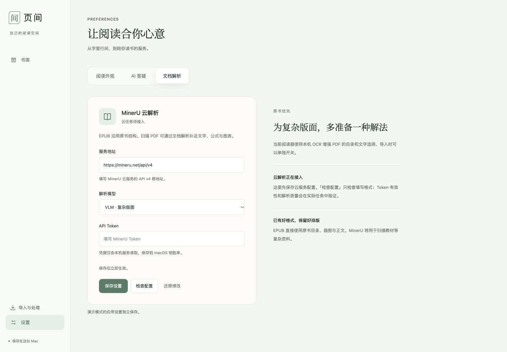

模型设置截图使用本机模拟服务与虚构模型 ID，见 [设置示例](docs/screenshots/model-settings.png)。真实模型另行验证，截图不展示私人地址或凭据。

## PDF 精细解析（2.17）

原 PDF 始终是阅读主体。MinerU 返回的区块映射回原页，只有选中时显示操作；公式提供完整 LaTeX，表格提供可粘贴到电子表格的制表符文字，图表和公式均可复制原图。后台保存任务断点，退出后可继续，不需要保持解析对话框打开。

云端只接收所选原页；每批最多 150 页，原文件保持不变。暂停表示停止本机后续操作，已提交的云任务可能继续，恢复时先查询原任务。解析额度与处理时间由服务方决定。识别与字符对齐仍可能有误，可随时对照原页。

匿名演示内附四页自编资料的真实解析结果，无 Token 也可检查完整公式、表格和图片取用；不会静默发起云调用。

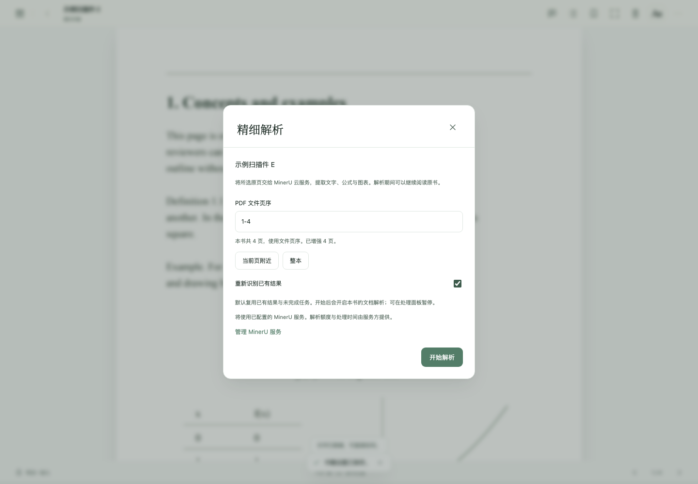

[暂停与继续](docs/screenshots/mineru-paused.png) · [原页完整表格取用](docs/screenshots/mineru-table-selection.png)

## 书内 AI 答疑

支持选中原文提问、围绕当前页提问、连续追问和本书对话记录。默认检索本书当前位置之前的资料，以编号来源供模型引用；可以取消勾选，改为只使用当前选段。每条对话保存原文选段、附近内容与位置，点击出处可回到书中，并使用阅读器的返回按钮回到跳转前的位置。

先通过上述「设置 → AI 答疑」配置。地址使用支持 `POST /chat/completions` 的 API 根地址，也可填写完整端点。协议参考 [Chat Completions 文档](https://api-docs.deepseek.com/api/create-chat-completion/)。开发环境也可复制 `.env.example` 并填写 `AI_BASE_URL`、`AI_MODEL`、`AI_API_KEY`，已保存的应用设置优先。

进入阅读页，选中文字后点「提问」，或点击顶栏「书内 AI 答疑」。`⌘Enter` 可发送问题。「本书记录」可重新打开已保存对话；失败回答可以重新生成。回答逐段显示，可以停止生成；已生成文字保留并可重新生成。生成时也可关闭面板继续读，稍后在本书记录查看。

发送会把选段、附近文字、检索到的此前资料和近期对话交给你配置的模型服务。每条回答保存本次使用的来源快照，后续重新索引也不改变已有引用。Key 不发给浏览器，也不保存在对话里；个人与匿名演示记录分别保存在被 Git 忽略的 `data/ai-conversations.json` 和 `demo-data/ai-conversations.json`。只有点击发送才调用模型，复制与阅读不调用模型。

回答支持 Markdown；已安装 Pandoc 时会将公式转为原生 MathML。未安装 Pandoc 时显示安全纯文本。模型输出中的脚本、外部图片与链接不会执行或发出请求。兼容接口支持 SSE 时逐段显示。图表提问可附带原图，见下节。

使用本机 SQLite 全文索引检索中文术语、英文正文和编号引用。默认排除当前位置之后的章节或区块；当前段之后的附近文字也不作为此前依据。扫描 PDF 仅包含已解析或已有文字的页，界面显示覆盖范围。检索是有界的词项匹配，不宣称已理解全部证明依赖；资料不足时模型应说明缺少的证据。

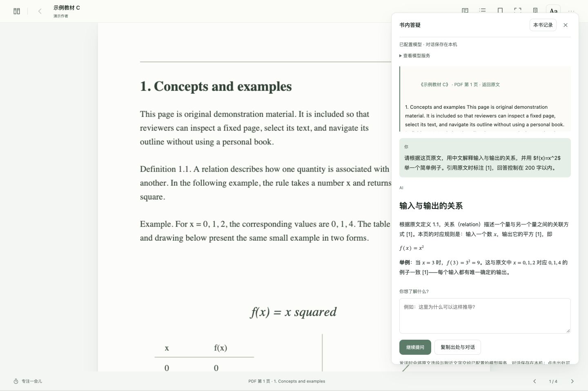

[本书记录示例](docs/screenshots/ai-history.png)

## 章节调整与图表答疑（2.21）

TXT 的「目录 → 调整章节」和书籍设置提供改名、合并、恢复上一版及重新识别；在正文选中起点，可直接分章。使用统一规则识别中文章 / 回 / 卷和英文章节，也识别无空格标题与重复的空目录项；不存在为私人图书单独编写的解析脚本。手工目录在关闭、重开解析时保留，原文件不改写；书签和问答出处按原文字符位置定位，目录变动后仍可返回。

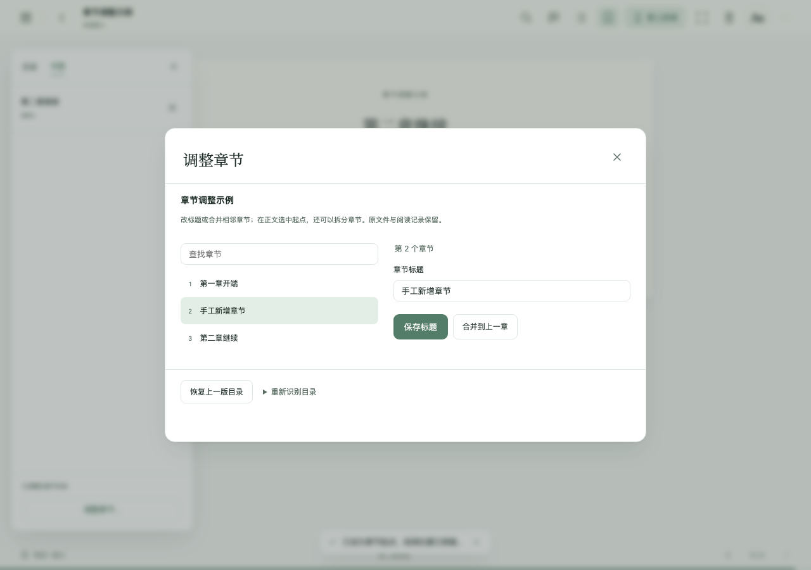

在模型设置中确认「此模型支持图像输入」后，选中整幅图表即可附图提问；每次问题都有「本次附带原图」开关，追问时也可取消。图片在本机转为有界 PNG / JPEG，去除元信息后才交给已配置的模型；随对话保存，并纳入备份。只支持文字的模型继续使用选段、LaTeX 或表格文字，不会自动收到图片。

PDF 划选穿过已解析的公式 / 表格时，取用完整对象；OCR 漏掉整张表格的文字时，透明对象锚点仍可参与跨区选取。EPUB 插图和 SVG 可在本机转为问题图片。来源图片限于当前书籍，服务不会代为下载任意外部图片地址。

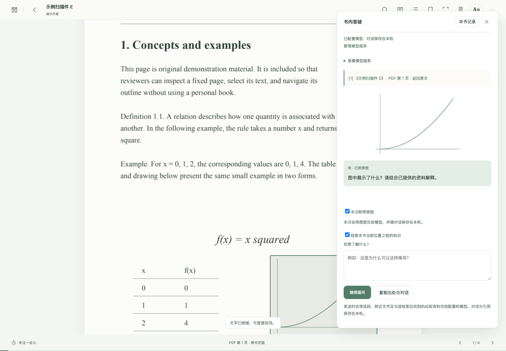

上图的回答来自本机可控服务，用于界面验证；真实模型另外完成原创图像及中英文教材原图测试，私人样本不公开。每条回答可展开本次实际发送的附近文字。此前知识按原文位置 / 区块阅读顺序过滤；无法确定 PDF 当前页内顺序时只纳入更早页面。回答出现没有对应资料的引用编号时会明确提示，编号存在也不等于证明推理正确。

## 导出与书库备份（2.19）

书籍设置中可以「导出 EPUB」。原生 EPUB 保留原书副本；TXT 导出章节；PDF 可以选择页段或整本，把已解析内容转为正文、MathML 公式、表格和插图。尚无文字的扫描页和无法排版的复杂公式保留原图。导出的 EPUB 重新导入后，在原 PDF 仍在书库时可一键查看对应原页，并返回继续阅读。

0.4.1 修复旧演示 EPUB 缺少容器类型、修改日期和 MathML 声明导致 Apple 图书无法读取的问题。导出前检查正文 / 目录入口，按需补齐副本的包信息和 ZIP 类型项，正文、插图与原文件保持不变；缺失正文资源会明确报错。符合这些检查的原生 EPUB 仍逐字节保留，不强制重排。应用内的结构预检不等同于完整标准校验；发布验证另外使用 [EPUBCheck](https://www.w3.org/publishing/epubcheck/)，不要求使用者安装 Java。

源码导出回归也可启用同一检查器：`EPUBCHECK_JAR=/path/to/epubcheck.jar python -m unittest discover -s tests -p 'export_test.py' -v`。它覆盖中英文示例、旧包修复、TXT、MathML / 表格 / 原图回退，遇到校验错误或警告即失败。

「设置 → 书库与数据」提供完整备份、恢复校验、取消、确认后重启恢复，以及找回恢复前的书库。备份包含图书与阅读积累，凭据继续留在本机钥匙串。未确认的备份不会在重启时启用；恢复失败保留原书库。

缓存清理在重启时执行，保留原书、记录、规范化解析结果和未完成的云任务断点。当前备份上限为压缩 2 GB、展开 10 GB。

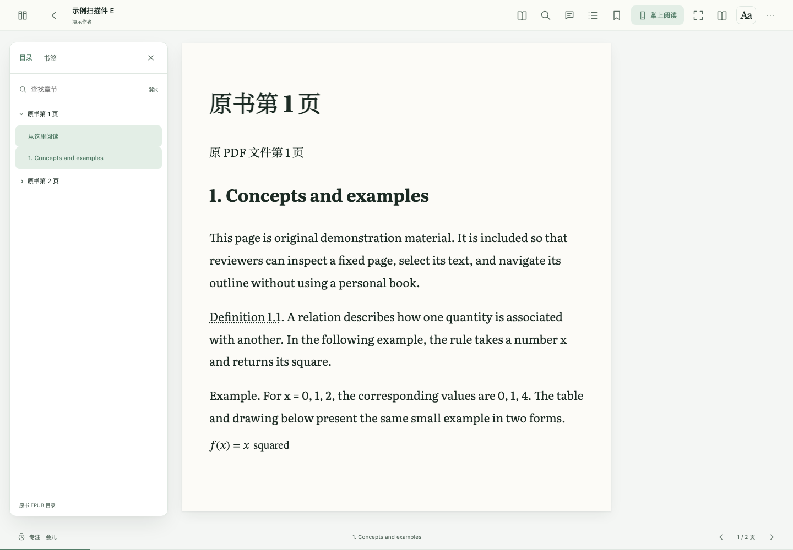

[备份校验和恢复确认](docs/screenshots/data-restore.png)

## 书内检索与引用（2.18）

阅读器的放大镜或 `⌘F` 可检索本书术语、原文和定理编号；结果先预览，再前往原文，使用返回按钮继续阅读。同号定义有多个候选时逐条列出，不直接猜测。文字书中的编号引用可点击检索，PDF 也可划选后使用「查书内」。

PDF 的校正保留原始文字几何，只在复制 / 提问时映射到可信的解析文字；支持跨段，无法可靠匹配的部分保留原文字。

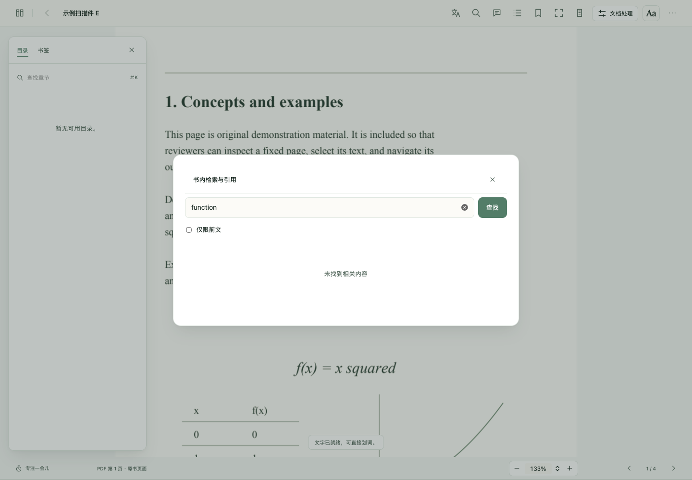

[带来源预览的答疑](docs/screenshots/book-ai-references.png) 使用本机可控模型演示界面；真实模型与复杂教材验证另见 QA.md。

## 当前功能

| 部分        | 已实现的行为                                                                           |
| ----------- | -------------------------------------------------------------------------------------- |
| 书库 / 常读 | 搜索、分类、常读筛选、继续阅读；卡片复用保留焦点，点击后进入独立阅读页                 |
| 导入与处理  | 多文件导入、逐本解析开关、后台任务面板、同文件去重；原文件副本留在本机                 |
| EPUB        | 读取 OPF spine、EPUB 3 nav / EPUB 2 NCX；保留正文、插图、样式、脚注和内部链接          |
| TXT         | 中文章 / 回 / 卷、英文 Chapter / Part / Book 共用规则；支持 UTF-8、UTF-16 BOM、GB18030 |
| PDF         | 保留原版面；原有书签与文字层优先，不足时按页 OCR；扫描目录识别及印刷页码映射           |
| 阅读方式    | 文字书默认轻滑与淡入淡出的分页；PDF 默认连续滚动；可切换分页 / 滚动                    |
| 位置与书签  | 目录搜索、跳转返回、同章多个书签；保存段落及字符锚点，排版变化后恢复内容位置           |
| 取用内容    | 划词复制、真实 AI 答疑、保存本书对话与出处回跳；EPUB 图片 / 表格 / MathML 可完整取用   |
| 字体与主题  | 中英文分别选字体，调字号 / 行距 / 宽度，四种主题，专注模式和计时                       |
| 掌上阅读    | 真实 macOS NSPanel，默认置顶；窗口缩小时同步缩放字号，独立保存浏览方式并共享阅读位置   |

### 支持的导入格式

| 格式                               | 路径                                              | 文档解析默认值 |
| ---------------------------------- | ------------------------------------------------- | -------------- |
| EPUB                               | 原生读取原书结构，不先转为 TXT                    | 关             |
| PDF                                | 原有结构优先，OCR 增强缺失能力                    | 开             |
| TXT                                | 统一章节规则，关闭时按全文阅读                    | 开             |
| MOBI / AZW / AZW3                  | 本地解包可直接读取的文件，接入 EPUB / HTML 阅读器 | 关             |
| FB2 / MD / HTML / DOCX / ODT / RTF | Pandoc 本地转换，再进入相同的阅读链路             | 关             |
| CBZ                                | 按文件数字顺序读取图像页                          | 关             |

开关可在导入时或书籍设置中调整。EPUB 关闭增强解析仍保留原有目录和插图。格式适配不代表所有厂商变体均已验证；加密 / 受保护文件不在直接读取范围内。

2.24 修复 Kindle 转换副本的目录与 EPUB 兼容性：优先保留解包后的 NCX 层级、章节锚点、插图和语言信息，旧 MOBI 正文在本机转换为 XHTML；生成符合 EPUB 3 的目录与包声明。原文件另外保留，原生 EPUB 的导入路径不改写正文。真实 MOBI / AZW3 样本的 16 项目录均保留，导出通过 EPUBCheck；这不等于已覆盖所有 Kindle 变体或 DRM 文件。

## 阅读界面改进（2.13）

书库合并常读筛选，导入状态移到按需打开的任务面板。星标操作保留卡片与键盘焦点；通知支持语义反馈和撤销。四种主题的辅助文字达到 AA 对比度，正文颜色达到 AAA，封面、遮罩和光影使用语义变量。保留字符锚点分页与个人排印偏好。

| 夜间书库                                            | 空状态与继续行动                            |
| --------------------------------------------------- | ------------------------------------------- |
|  |  |

[常读撤销反馈](docs/screenshots/feedback.png) · [章节失败与重试](docs/screenshots/retry.png)

## 页面与交互预览

下列画面均来自同一套可运行的匿名演示，而非设计稿或真实阅读资料。

| 沉浸阅读                                 | 阅读设置                                         |
| ---------------------------------------- | ------------------------------------------------ |
| 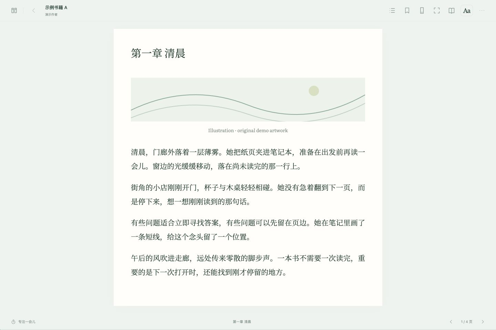 |  |

| 扫描 PDF 划词提问                                        | 导入选项                                         |
| -------------------------------------------------------- | ------------------------------------------------ |
| 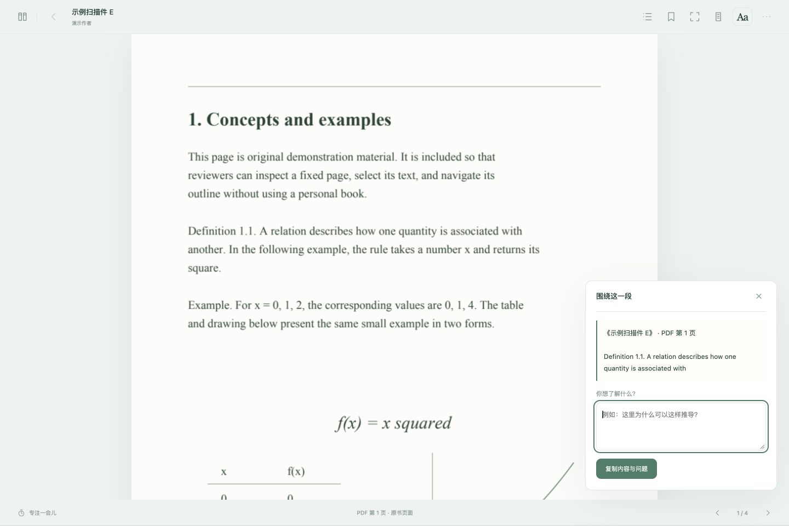 | 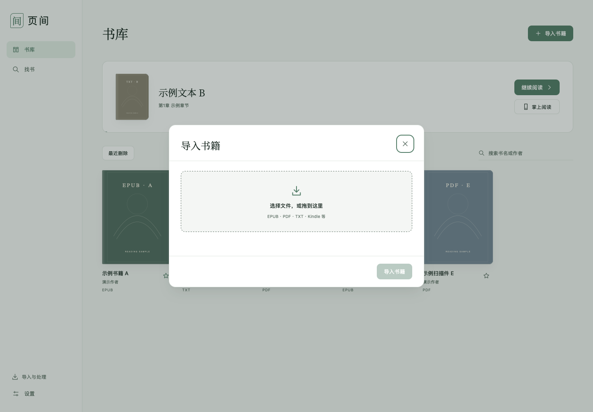 |

| 掌上窗口                                   | 导入与处理                                |
| ------------------------------------------ | ----------------------------------------- |
|  |  |

翻页改为约 480 ms 的轻缓位移与淡入淡出，保持实际正文的选择几何位置，弱化阴影。章内分页、跨章导航和掌上模式采用相近的节奏；开启系统“减少动态效果”后直接切页。特别长的未分章文档使用轻淡入，避免复制整本 DOM。

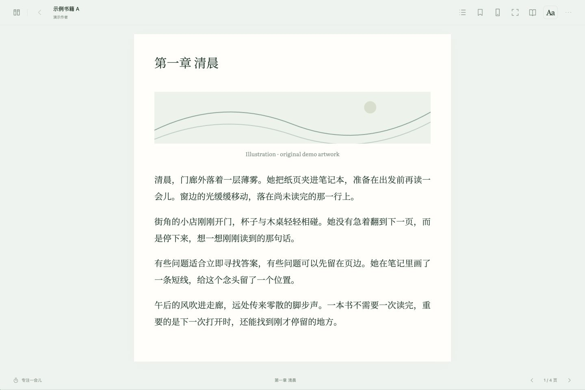

### 常用操作

- `←` / `→`、`PageUp` / `PageDown`、空格：阅读翻页；也可使用触控板和底部按钮。
- `⌘K`：书库中检索书籍，阅读中检索本书目录；`⌘B`：添加 / 移除书签。
- `⌘G`：跳页；`⌘[` / `⌘]`：前后章节，PDF 为前后文件页；`Esc` 在书库中清空筛选。
- 点击页码：跳转当前章节屏幕页或 PDF 文件页序。
- `F`：专注阅读；`Esc`：收起浮层 / 退出专注。
- 阅读器顶部「掌上阅读」：打开 macOS 掌上窗口；图钉按钮切换置顶。
- 常读切换和删除书签后，可在通知中撤销；悬停或键盘聚焦通知时暂停消失计时。
- 掌上设置提供标准 `344×560` 和小巧 `280×440` 尺寸；字号随可用面积调整。

## 给评审者

请先阅读 [与评审 AI 的沟通记录](docs/REVIEW_DIALOGUE.md)：本轮建议的处理状态、源码判断校正和下一轮问题都会持续维护在这里。

- [产品范围与逐项功能](docs/FEATURES.md)：明确当前能力、交互路径和已知边界。
- [产品 / UI 评审说明与提示词](docs/PRODUCT_REVIEW.md)：适合交给产品专家和设计评审 AI。
- [代码评审说明与提示词](docs/CODE_REVIEW.md)：包含建议阅读顺序、重点风险与输出要求。
- [架构、索引与数据流](docs/ARCHITECTURE.md)：解释格式适配、PDF 选择层、分页和小窗同步。
- [验证记录](QA.md)：自动检查与本机交互验证的实际范围。
- [字体清单](FONTS.md) / [第三方资源](THIRD_PARTY_NOTICES.md)。

## 目录结构

```text
index.html             页面与对话框入口
app-v2.mjs             路由、阅读状态、目录、选择、设置及窗口同步
ui/                    复用书籍卡片、语义通知与撤销、图标和转义
page-layout.mjs        实时 DOM 分页与柔和换页动画
core.mjs               TXT 章节、编码、进度与掌上字号计算
server.py              本地 HTTP / 导入 / 任务 / 状态 / AI 接口
ai_tutor.py            模型配置、真实请求、对话存储、来源与安全排版
storage.py             共享 JSON 原子读写
book_import.py         格式适配与原生 EPUB 结构读取
pdf_enhancement.py     OCR、扫描目录、页码校准、区块内保守修正
paths.py               个人与演示资料隔离、运行路径
native/                Swift OCR 与 NSPanel / WKWebView 小窗
scripts/create_demo.py 原创演示 EPUB / TXT / PDF / 扫描件生成
scripts/check_publication.py 发布文件检查
assets/fonts/          阅读字体及许可证
assets/vendor/         PDF.js、WASM、CMap 及许可证
tests/                 无需私人图书的回归测试
docs/                  评审指南及匿名截图
```

## 验证

```sh
node --check app-v2.mjs
node tests/core.test.mjs
node tests/layout.test.mjs
node tests/page-turn.test.mjs
node tests/library.test.mjs
node tests/theme.test.mjs
node tests/jobs.test.mjs
node tests/feedback.test.mjs
python -m unittest discover -s tests -p '*_test.py' -v
```

目录交互回归可在隔离的匿名演示服务上运行：`node scripts/verify_navigation.cjs http://127.0.0.1:8779 chromium`，或将最后参数改为 `webkit`。它使用 Playwright 和 Python 标准库生成原创 EPUB，验证共享正文目录、书签、重开、掌上模式及目录焦点；不要对个人书库运行修改型验证。

准备提交时还可运行：

```sh
python scripts/check_publication.py
```

该检查读取 Git 索引中的实际待发布文件，拒绝数据目录、凭据文件、个人绝对路径和常见密钥格式。额外的本地排除词可以通过 `--deny-file` 指定，排除词文件本身不应提交。截图还需人工确认只含生成的示例资料。

## 当前边界

- AI 已支持书内检索、此前位置过滤、文字与原图提问及对话保存；检索范围以本书索引覆盖情况为准。
- MinerU 已接通所选页段、分批处理和任务恢复。编号引用支持检索、预览、跳转与返回；内容解析和回答质量仍按实际来源核对。
- OCR 可能出错，尤其数学公式；字符精确对齐、跨页取用及不确定性表达仍待完善。
- 后台全局翻页快捷键已注册，当前可靠验证范围为聚焦小窗的方向键；离焦触发需进一步复核。
- 特殊固定排版、竖排、多媒体 EPUB、超大文件与全部 Kindle 变体尚未全面验证。
- 真实 MOBI / AZW3 样本的目录丢失和导出标准问题已修复；其他厂商变体仍须通过本机样本验收。
- 存储采用本机 JSON 文件，仍需要进一步审查并发、崩溃恢复和大书的资源占用。

项目尚未指定项目级开源许可证。随仓库分发的第三方字体、PDF.js 与相关资源保留各自许可证。
