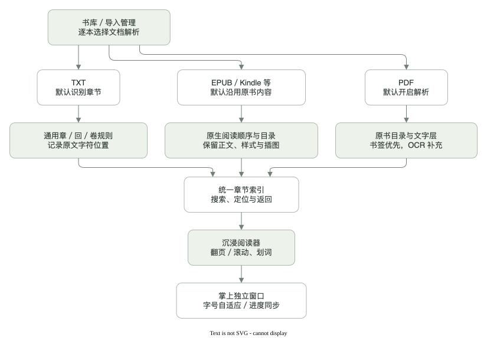

# 架构、索引与阅读位置

## 当前结构

浏览器处理阅读 UI，Python 提供本地导入、OCR、任务与存储。Swift 组件只负责 macOS Vision OCR 和 NSPanel / WKWebView 掌上窗口。原型没有前端打包步骤，也没有云服务。

## 输入如何变成阅读资料

| 来源            | 索引来源                                     | 阅读定位                     |
| --------------- | -------------------------------------------- | ---------------------------- |
| EPUB 3 / EPUB 2 | 原生 nav / NCX，缺少时沿用 OPF spine         | 正文文件 + 段落锚点          |
| PDF             | 原有 outline 优先，否则 OCR 读取扫描目录     | 实际文件页序；印刷页码另映射 |
| TXT             | 共用章 / 回 / 卷、Chapter / Part / Book 规则 | 章节 + 归一化原文字符位置    |
| 其他文档        | 本地格式适配器读取或转换                     | 对应文件、标题与锚点         |
| CBZ             | 图像文件自然数字顺序                         | 对应图像页                   |

前端得到统一目录节点，包含标题、文件 / 页序、片段锚点和子节点。目录 UI 不为特定书籍定制规则。

扫描目录流程查看前 48 页，识别目录标题 / 引导线，对候选页细读，合并同行标题与页码并区分双栏，再用正文页眉 / 页脚的重复一致偏移校准文件页序。无法确认时保留未确定状态，允许手动校正。

## 为什么原 PDF 上能选择文字

页面仍由 PDF.js 显示。原生文字层可用时直接使用；扫描页在后台按页 OCR，再把文字坐标放在透明选择层中。平时只显示原版面，选中后才出现工具栏。

Vision 负责中文 / 快速布局识别，Tesseract 负责英文精细识别。已有外部增强 JSON 可以提供完整对象与区块内保守修正，但当前不自动调用 MinerU 全书 API。

OCR 文字与原页面可能不完全一致，尤其数学公式。透明文字层解决可选取问题，不等于已经解决识别准确率与字符级精确对齐。

## 分页、动画与锚点

EPUB 和 TXT 使用真实 DOM 多栏，而非不可选择的整页截图。每栏对应一屏，字体、宽度或窗口变化后重新排页。

动画层是临时的旧页副本，做少量水平位移与淡出；实际正文只做透明度过渡，其选择几何位置保持固定。重复翻页先取消并清理旧动画。减少动态效果时直接切页，过长全文不克隆整本 DOM。

阅读位置使用章节、段落特征和段内字符位置；TXT 另存归一化原文的字符偏移。通过 Range 几何计算可见文字，避免设置弹窗遮挡造成段内位置丢失。程序恢复时保留原锚点，实际翻页 / 滚动后才更新位置。

## 小窗与主窗口

掌上窗口加载同一个阅读页面的 `mode=palm` 分支。默认置顶，可取消；字号按窗口可用面积的平方根缩放，并限制在可用区间内。

两个窗口通过本地服务共享状态，约 1.8 秒检查更新；程序恢复位置时抑制重复写回。窗口打开 / 复用通过本地状态与指令文件协调，启动新窗口前清理过期指令。

## 文件与进程

`paths.py` 统一选择 `data/` 或 `demo-data/`。两者的资料、缓存和窗口状态分开；生成样本只写演示目录。原生二进制构建到 `~/.cache/page-between/` 的独立模式目录，不加入 Git。

| 文件                                     | 内容                                 |
| ---------------------------------------- | ------------------------------------ |
| `library.json`                           | 书籍元数据、目录、解析开关、任务状态 |
| `books/<id>/`                            | 导入副本、正文、图片、字体、转换结果 |
| `state.json`                             | 偏好、进度、书签                     |
| `cache/ocr-v2/`                          | 按书 / 页 / 模式缓存的 OCR           |
| `palm-window.json` / `palm-command.json` | 原生窗口状态和复用指令               |

HTTP 只绑定回环地址，检查 Host / Origin；静态读取隐藏文件受限，非活动资料目录与原始状态文件不通过静态路径提供。电子书内容在禁用脚本和外部连接的 iframe 中显示，包内资源需要保持在本书目录范围。

## 本地接口

| 方法与路径                                 | 作用                                 |
| ------------------------------------------ | ------------------------------------ |
| GET `/api/library`、`/api/library-version` | 书籍、任务与变更版本                 |
| GET `/api/formats`                         | 支持格式、默认解析值与原生小窗可用性 |
| POST `/api/import`                         | 原始文件导入与去重                   |
| POST `/api/books/<id>`                     | 书籍设置和页码校正                   |
| GET / POST `/api/state`                    | 共享阅读状态与偏好                   |
| GET `/api/ocr?book=...&page=...`           | 当前扫描页的文字与对象               |
| POST `/api/palm`、GET `/api/palm-status`   | 开启 / 复用原生小窗及状态            |

接口是本地原型协议，尚未作为稳定 SDK。未来是否复用到正式 macOS 应用，应在阅读交互稳定后再决定。

## 2.13 的界面模块

`ui/library.mjs` 按 ID 缓存书籍卡片，筛选只改变可见性，星标不替换按钮或图片。`ui/feedback.mjs` 管理有语义、可暂停计时和可撤销的通知；撤销动作继续使用原有书籍 / 书签接口。`ui/shared.mjs` 集中图标与 HTML 转义。主脚本仍协调已有阅读状态和服务通信，没有引入第二套状态存储。

常读成为书库筛选；导入处理结果由侧栏底部打开对话框查看。旧 shelf / imports 路由兼容转入新的入口。具体取舍见 [评审沟通记录](REVIEW_DIALOGUE.md)。
