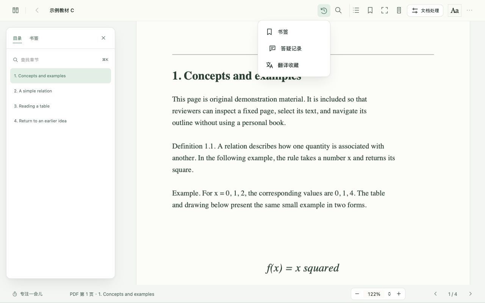
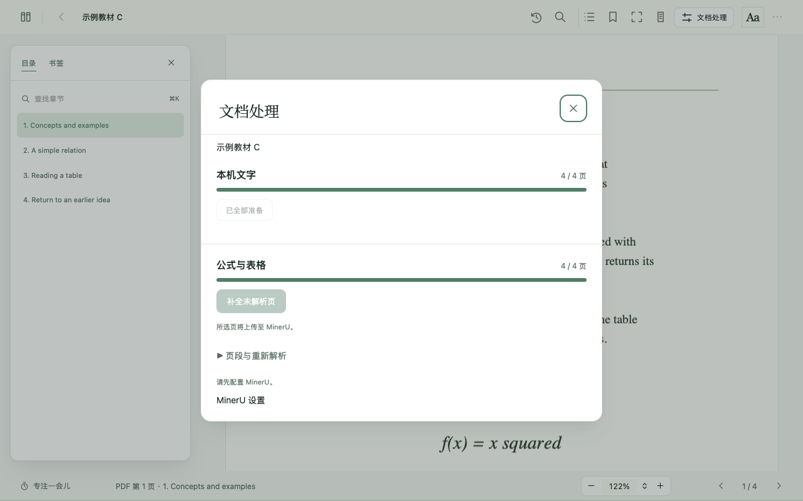

# 产品分析报告落实清单

## 2026-11-06 再评估

对应《页间：界面美学与产品体验再评估》。用户随后要求继续实现所有有用建议，本轮范围扩展至现有流程修复、书库与阅读布局、单书偏好、页边闭环及本地备份。以下状态按功能区分，验收证据单独维护在 QA.md 与 ios/QA.md。

| 报告建议 | 实现与边界 |
| --- | --- |
| P0 未读书／假进度／续读筛选 | 完成。有效保存位置决定续读，真实零进度保留为零，文件夹、类型、常读和搜索共用候选范围。 |
| P0 下载大小预检 | 完成。已知超过 200 MB 提前禁用，后端在申请下载前核对，下载完成后继续检查实际文件。 |
| P0 下载离页与任务访问 | 完成。任务独立于详情页，可返回搜索、打开其他版本或离开找书。侧栏保留任务入口，重新加载页面可恢复当前后台任务。完成操作只更新所属版本，任务中保留开始阅读入口。采用后台任务方案。 |
| P0 自动页码映射 | 完成。清空偏移恢复自动映射，新增结果记录自动基线，旧 OCR 目录从已有识别资料重新核对；原始目录目标高度与书签物理位置保留。手工偏移重做目录时继续生效。 |
| P0 书籍设置进入处理面板 | 完成。使用“保存并处理”，完整保存标题、类别、文件夹、解析开关与页码偏移。 |
| P0 导入完成直接阅读 | 完成。单本“开始阅读”，多本“阅读第一本”，同时可回到书库。失败文件保留重试。 |
| P0 书源退出账号 | 完成。移除本机邮箱、密码与旧凭据引用，关闭书源会话；下载进行时提示完成后再更改账号。 |
| 格式查询失败 | 完成。区分“暂时无法确认”与不支持格式，并提供重试。 |
| P1 书卡与续读层级 | 完成。书名 16px、作者 12px、必要元数据 11px，续读横条收紧，掌上入口降低视觉重量，长书名保留完整可访问名称。 |
| P1 文件夹与筛选 | 完成。文件夹位于左栏，类型、常读与搜索留在同一工具行。窄窗口转为横向范围导航。 |
| P1 小说／教材工作区 | 完成。按用户设置的书籍类别选择默认常用入口，小说翻页后工具可淡出，教材保留研读工具。用户此前要求目录默认展开，因此宽窗继续默认展开，并记住每本书的显式选择。 |
| P1 三组排版预设 | 完成。沉浸、舒展、紧凑成组调整字号、行距与段落节奏，有当前选中态，独立滑杆可继续微调。EPUB 保留原书标题、图像和脚注结构。iPhone 使用对应相对字号与行距。 |
| P1 章节与颜色 | 完成。暖中性底色、较强正文墨色、松绿强调；去除细小花饰，调整章节标题与留白。无封面使用按书名稳定选择的有限配色与排印，原封面优先。 |
| P1 设置分组 | 完成。阅读、服务与隐私、书库与数据三个分组。服务内保留必要的配置名称与错误。外观可切换示例文字与最近阅读的文本。 |
| P1 焦点与 ARIA | 完成。目录浮层接收焦点，关闭后返回入口；设置所有关闭路径同步 expanded 状态，主阅读区保留键盘焦点。工具淡出仅改透明度。 |
| PDF 夜间原图 | 完成。默认保留原页颜色，柔化与黑白反色分开选择，并按书保存。 |
| 翻译恢复与出处 | 完成。Google 失败保留重译和服务切换，AI 配置入口按当前服务显示；收藏列表直接显示出处。单词使用较窄浮层。 |
| 选段动作层级 | 完成。单词优先翻译，公式／图像优先提问；固定引用与 TXT 分章位于更多操作中。 |
| 数学答疑与小说范围 | 完成。教材提供解释这一步、展开推导、给一个提示；小说附带文字限制在当前位置以前，并要求回答避开后续情节。来源与已有检索范围继续沿用。 |
| P2 页边最小闭环 | 完成。主动保存文字、公式、表格或图像，保留原文、精确位置、时间、短笔记。按书与章节浏览，返回原文，删除及撤销，纳入完整备份。原 PDF 与解析视图使用同一来源记录。 |
| P2 统一回看与关联 | 完成。页边入口按类型浏览选段、书签、翻译收藏与答疑，沿用已有存储。译文和答疑可主动保存成带原文的快照。 |
| P2 单书偏好与工具固定 | 完成。Mac 保存每本书的字号、字体、浏览方式、目录与页面外观；常用工具可选择 1–2 个入口。iPhone 保存单书外观，专用写入保护新记录不被旧书籍元数据覆盖。 |
| P2 教材单一固定引用 | 完成 macOS 版。固定选段或当前 PDF 原页，继续在原位置阅读，可拖动、缩放并返回来源。 |
| P2 开放导出 | 完成。Mac 导出本书选段、书签、译文与答疑的开放 JSON 或 Markdown ZIP，图像随包保存。iPhone 页边可导出 JSON 或含原图的 Markdown ZIP。 |
| P2 备份状态与本地自动备份 | 完成 macOS 版。每日／每周可选，默认关闭，保存最近三份自动备份，失败保留上次成功状态。原生保存完成后才记录手动备份成功时间。 |
| 迁移前预览 | 完成 macOS 版。显示可迁移本数、原件预计体积、跳过原因及大小限制，实际导出再次核对。 |
| iPhone 共享原则 | 已同步单书排版、三组预设、保存选段、短笔记、回跳、撤销与导出，沿用原生菜单和 sheet。完整云端检查通过 38 项核心与 7 条原生界面，以及迁移、OCR、MinerU 和打包资源。真机验收范围见 [QA.md](../QA.md) 与 ios/QA.md。 |

### 保留为条件项

报告 P3 自身以“确有使用后再做”为前提。双页工作台、自定义提示词、本机词典／模型深度集成、带注释 PDF 导出与全量跨端记录同步，继续作为条件项。当前用单一固定引用、现有模型设置、开放记录导出和文件迁移解决对应的直接任务。

两处保留产品判断。目录默认展开遵循用户既有明确要求，避免升级改掉阅读习惯。本地定时完整备份与固定原页先在 Mac 落地，手机继续使用原生选段、系统文件导出及现有迁移通路。

## 2026-11-03 首次评估

对应《页间：产品、界面与阅读体验评估》（2026-11-03），逐项核对至 2026-11-05。上一轮完成主要 P1 与首屏调整，本轮补齐文档处理、记录入口与主题检查；用户另选择增加设备间迁移。

| 原报告 | 处理与结果 |
| --- | --- |
| §4 目录遮挡 | 已完成。宽窗预留正文空间；窄窗默认收起，目录与设置互斥，打开和关闭保留位置。 |
| §5.1 书库首屏、最近删除 | 已完成。继续阅读收紧，1280×720 可见第一排书名；最近删除位于管理菜单。 |
| §5.2 文件夹与类型筛选 | 已完成。范围导航与列表工具分组，“所有类型”与文件夹区分；清除类型筛选保留当前文件夹。 |
| §5.3 每本进度 | 已完成。卡片显示已有进度；未开始的书不虚构数字。 |
| §5.4 格式与导入 | 已完成。统一支持表，实际版本格式在下载前校验；不支持的格式不消耗下载请求。 |
| §6.1 工具分组 | 已完成。导航、显示与记录各自分组，保留名称、快捷键和辅助功能。掌上阅读保留直接入口。 |
| §6.2 正文密度 | 已完成。提供紧凑／舒展预设，仍可独立调字号与行距；不一刀切改写 EPUB 原书结构。默认偏好最终由实际阅读决定。 |
| §6.3 小字、对比、焦点 | 已完成。位置栏字号增强；四主题实测关键次要文字和主按钮对比，键盘 Tab 焦点可见；蓝色主按钮颜色加深。不是对任意原书内容的无障碍认证。 |
| §7.1 PDF 缩放 | 已完成。设置与底栏读取实际比例，切换和重排保留位置。 |
| §7.2 文档处理 | 已完成。本机文字、公式与表格分区显示进度；整本、暂停／继续为主操作；页段、重做按需展开。上传提示与错误保留，错误不会藏进折叠区。iPhone 同步采用分区和展开项。 |
| §8.1 回看入口 | 已完成。macOS “阅读记录”聚合书签、答疑和翻译收藏，沿用原数据与返回原文路径；iPhone 聚合现有书签／答疑，未伪造其尚无的翻译收藏能力。 |
| §8.2 伴学闭环 | 保留现有实现并回归。出处、返回原文、停止／重试与本书记录继续使用；不承诺不同外部模型的答案质量，不把 UI 整理宣称为新增全书定理推理。 |
| §9 产品比较 | 作为参考，不是要求复制所有产品。没有引入社交、商城、运营任务或订阅。 |
| §10 视觉 | 已落实于上述界面：沿用纸白与低饱和主题，减弱管理操作，统一控件、间距和焦点；原封面、字体、可关闭／减少动效保留。 |
| §11 平台关系 | 已补设备迁移：Mac 与 iPhone 通过文件包互传书籍、进度和书签；各设备保持独立书库，不宣称自动同步。真机仍待用户准备设备后验收。 |
| §12 数据边界 | 保留本地原件、按书进度、原有书签／对话、主动翻译收藏与桌面完整备份语义。迁移不取代完整备份。 |
| §13 五条固定路线 | 原创示例覆盖导入／继续阅读、目录／缩放、书签／返回、空与失败状态、浅／夜间和窄窗；具体证据见 QA.md、ios/QA.md。 |

## 按用户选择处理的建议

2026-11-03 首次报告当轮，用户选择设备迁移，原文选段当时留作后续能力。2026-11-06 再评估后，用户授权继续实现有用建议，本轮已增加页边，范围与验收见上表。文件迁移继续保留明确的重复处理规则。

没有把报告的大多数建议判为“不合理”。区别在于：已复现问题必须修复；主观排版保留选择；跨端与批注等新增能力需要明确需求；真机手势和真实模型质量不能由模拟器或静态截图代替验收。

## 本轮界面

以下为原创示例资料，未展示个人书籍。

跨端操作见 [迁移说明](TRANSFER.md)。
