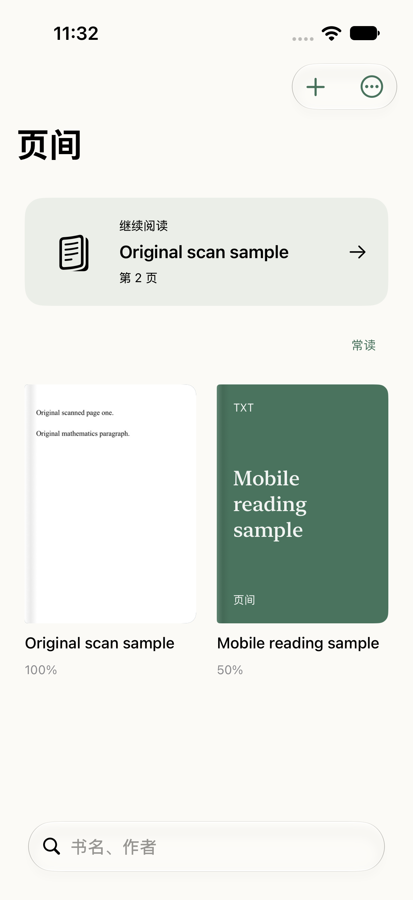
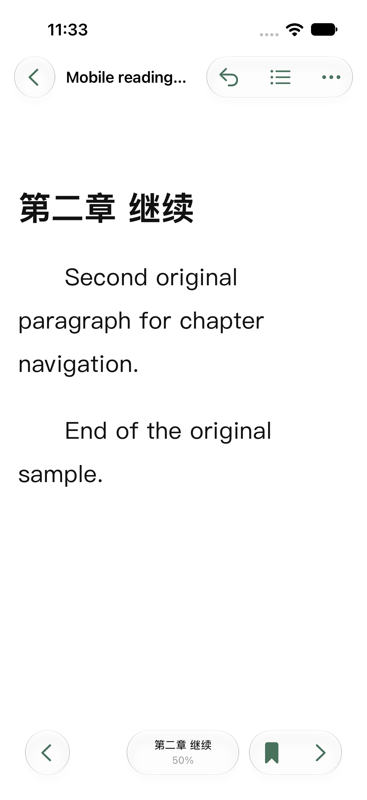
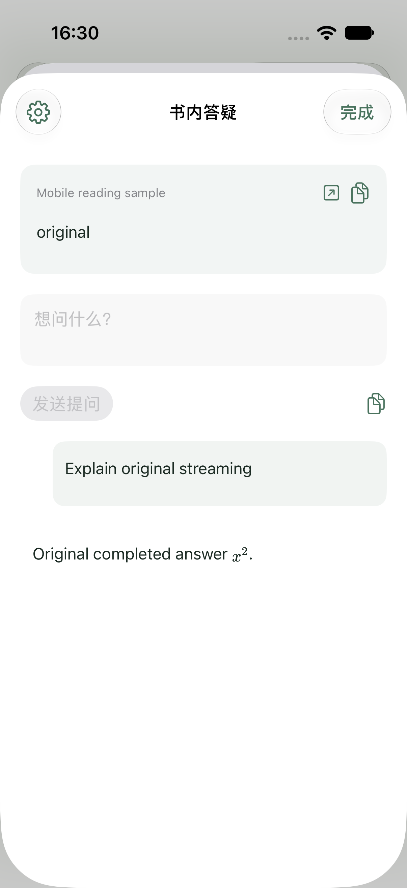

# 页间 · iPhone

原生 SwiftUI iPhone 客户端，面向 iOS 17 及以上。书籍和进度保存在手机，通过 Readium 阅读 EPUB、TXT 转换后的 EPUB 与 CBZ，通过 PDFKit 阅读 PDF；不依赖 Mac 或本地 Python 服务。

当前为 **0.1.0 开发版**，已在 iPhone 模拟器中运行。真机先通过连接 Mac 安装，签名与设备准备稍后进行；目前尚未提供手机安装包。

| 书库 | 阅读 | 书内答疑 |
| --- | --- | --- |
|  |  |  |

## 功能

- 书库、原书封面、搜索、常读、文件导入、最近删除和恢复；相同文件按内容去重。
- EPUB 原书目录和插图；TXT 自动分章、编码检测与长篇拆分；PDF 原页阅读。
- 扫描 PDF 本机 OCR、附近页提前准备、长期保存与整本暂停续作；已导入 PDF 可从“文档处理”操作。
- MinerU 配置、整本／页段／补全、分批上传和任务恢复已接入；真实云端与复杂原书验收仍在进行。
- 触控翻页、连续滚动、目录跳转和返回、书签、进度保存、字号、字体与纸张设置。
- 系统划词菜单中的提问／翻译；AI 与 Google 翻译、独立翻译模型配置。
- PDF 选段按位置匹配已解析原文；公式、表格与图片可整对象取用，损坏公式可显示原页裁图，复制保留原始内容。
- 答疑模型可开启图像输入，并在提问时选择附带原图；原图临时生成，不写入新的图片缓存。
- Markdown 和 LaTeX 显示，复制保留源码；服务密钥使用本机钥匙串，翻译不自动保存。
- 答疑流式显示，支持停止与重新生成；按书保存选段、出处与连续对话，可回看并返回原文，关闭弹窗后可再次打开最近选段。

阅读时左右滑动或使用底栏翻页，点按正文收起工具栏；长按选择文字后可复制、提问或翻译。AI 服务可从书库设置或答疑窗口左上角配置。

完整书内知识检索、其他电子书格式、备份导出和找书等仍在移植。复杂原书与真实云服务继续验收，进度见 [完整清单](PORTING.md)。

## 用 Xcode 打开

打开 `PageBetween.xcodeproj`，选择 `PageBetween` Scheme 和 iPhone 模拟器。Swift Package Manager 会解析固定的 Readium 3.11.1 与 ReadiumZIPFoundation 3.0.1，以及已锁定的依赖。

```sh
xcodebuild -resolvePackageDependencies -project ios/PageBetween.xcodeproj -scheme PageBetween
xcodebuild -project ios/PageBetween.xcodeproj -scheme PageBetween \
  -destination 'generic/platform=iOS Simulator' CODE_SIGNING_ALLOWED=NO build
```

用数据线连接 iPhone、信任 Mac，在 Xcode 的 Signing & Capabilities 中选择自己的开发团队和已连接设备，再运行安装。不要把签名证书、描述文件或服务密钥提交到仓库。

排版依赖已随源码保存，离线阅读时不从 CDN 加载代码。密钥不随书籍导出或上传。

开发验证与当前限制见 [QA](QA.md)。
